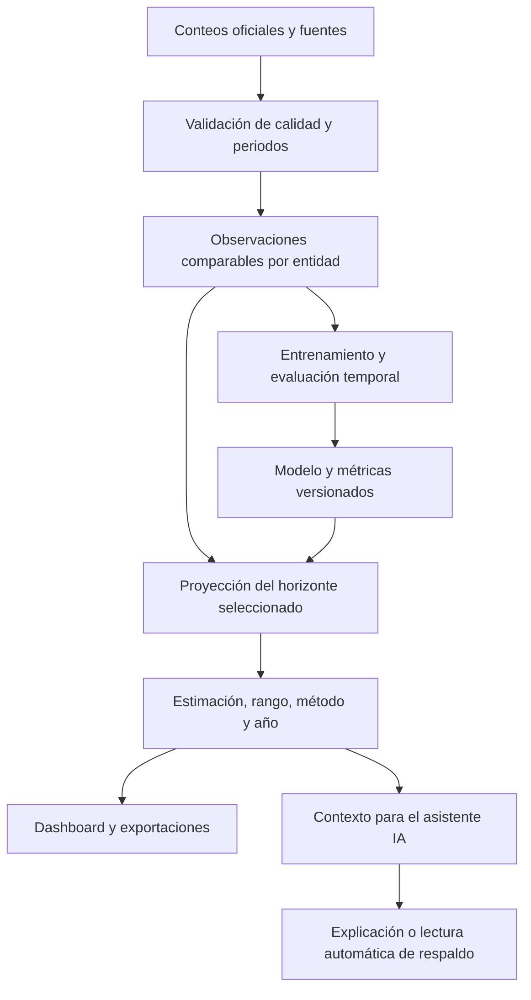
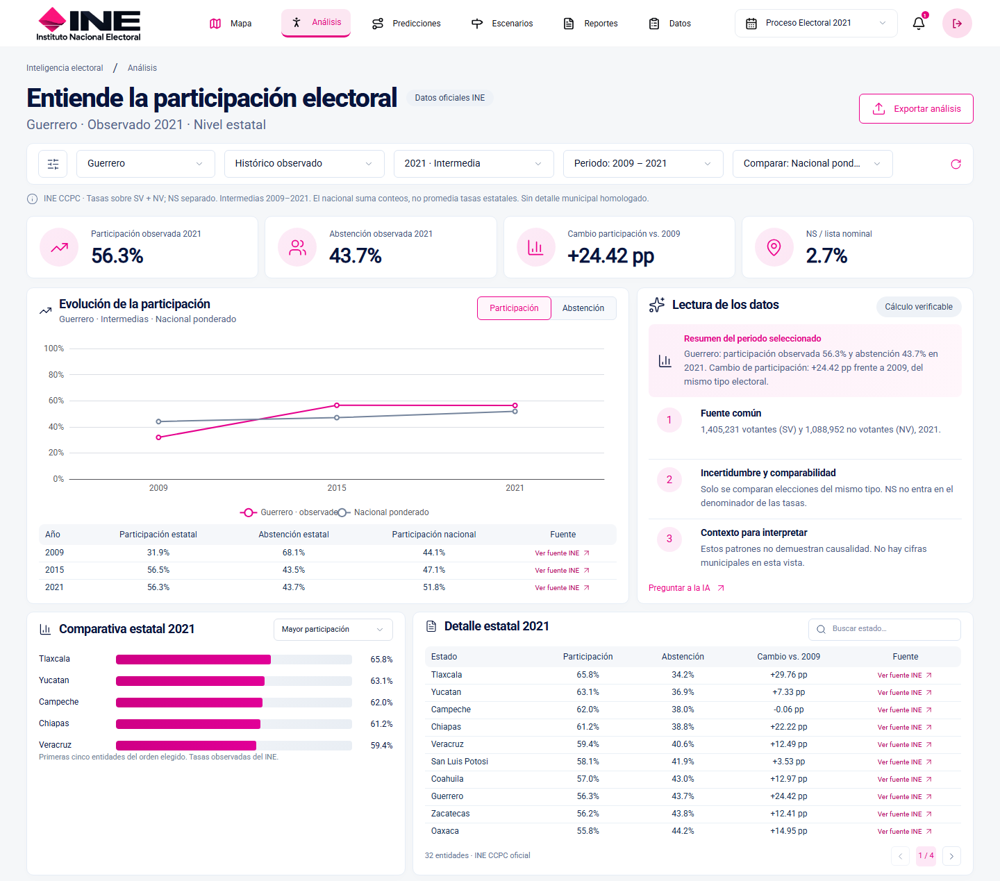
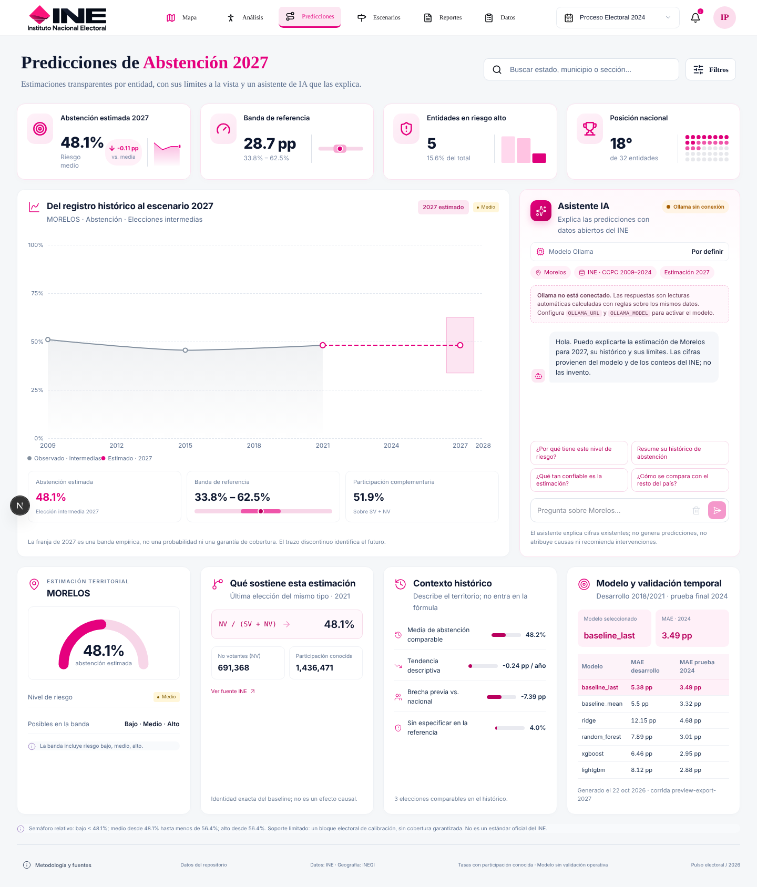
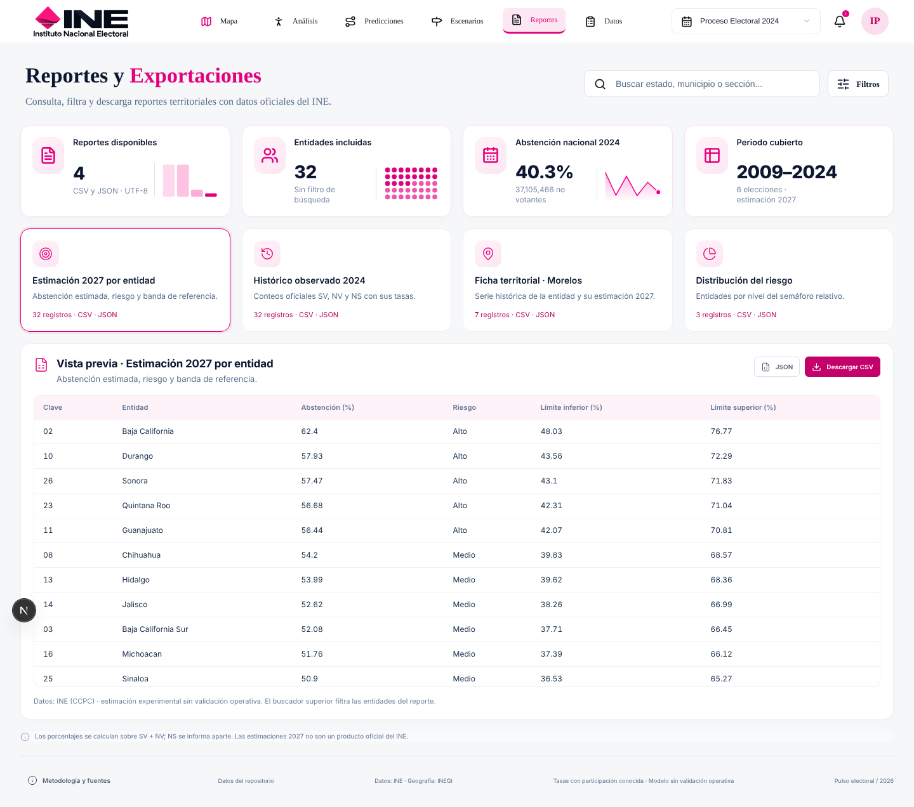
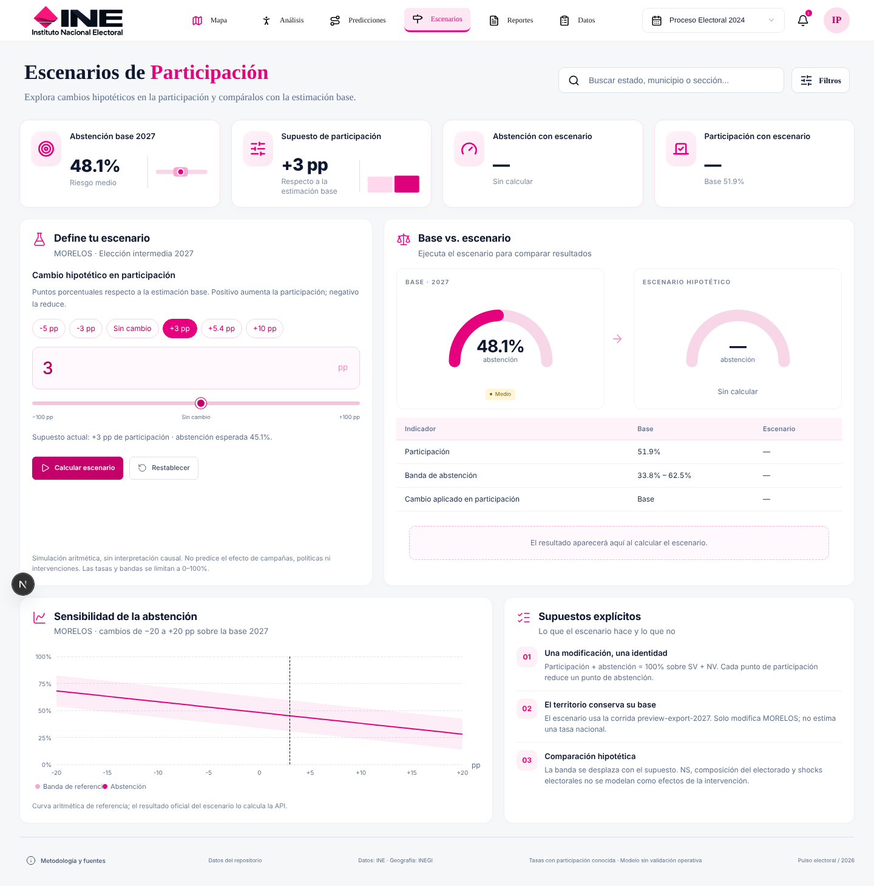
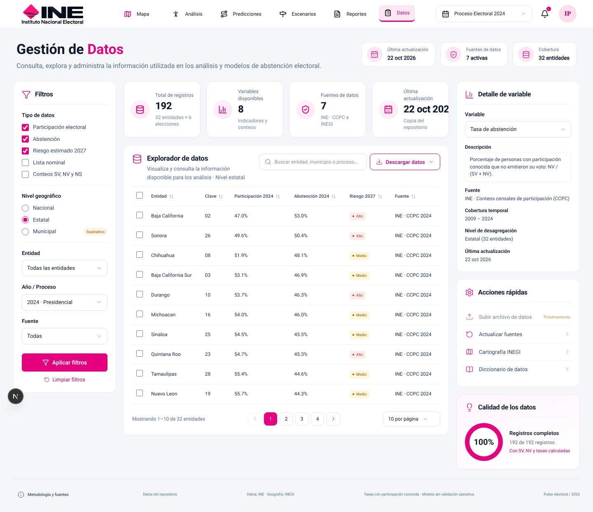
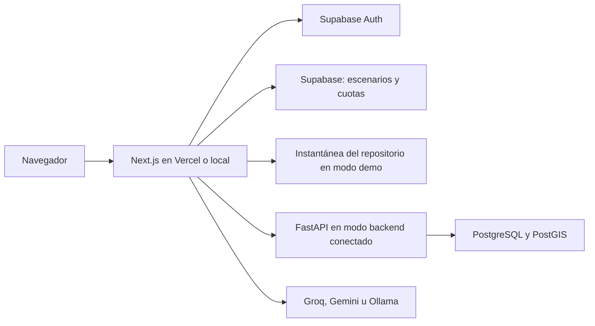
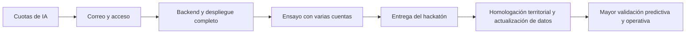

# Atlas De La Participación

Dashboard de participación y abstención electoral en México que reúne datos abiertos del
INE, mapas estatales, análisis histórico, modelos de machine learning, proyecciones y reportes.
Su objetivo es hacer visibles las cifras, su procedencia y sus límites en una misma interfaz.

**Estado documental: 30 de octubre de 2026.** Basado en la integración `266bf0e` (PR #52).
El código integrado no acredita por sí solo que las variables, migraciones y servicios remotos
ya estén configurados. Es un prototipo experimental independiente, sin aval institucional del INE.

[Demo](https://pulso-electoral-demo.vercel.app) · [Instalación](docs/installation.md) ·
[Datos y metodología](docs/phase2.md) · [Resultados ML](docs/phase4_results.md) ·
[Galería](docs/dashboard-gallery.md)

## Contenido

- [Qué permite hacer](#qué-permite-hacer)
- [Recorrido del usuario](#recorrido-del-usuario)
- [Datos y fórmulas](#datos-y-fórmulas)
- [Machine learning y predicción](#machine-learning-y-predicción)
- [Diseño e identidad visual](#diseño-e-identidad-visual)
- [Arquitectura](#arquitectura)
- [Incorporaciones recientes](#incorporaciones-recientes)
- [Validación y pendientes](#validación-y-pendientes)
- [Hoja de ruta: los nueve puntos](#hoja-de-ruta-los-nueve-puntos-del-sistema)
- [Ejecutar en local](#ejecutar-en-local)

### Acceso de prueba para el hackathon

Entrar en [la demo](https://pulso-electoral-demo.vercel.app/login) con una de las dos cuentas confirmadas:

| Correo | Contraseña de demo |
| --- | --- |
| `pulso.qa.20261025.1@example.com` | `PulsoDemo2026!` |
| `pulso.qa.20261025.2@example.com` | `PulsoDemo2026!` |

Ambas cuentas son usuarios normales de la aplicación y comparten acceso público para las pruebas
del hackathon. No guardar información personal en sus escenarios. Los correos son ficticios y no
reciben enlaces de recuperación. La creación y las pruebas de acceso están documentadas en
[Auth](frontend/AUTH.md).

## Qué permite hacer

| Apartado | Qué representa y para qué sirve | Alcance |
| --- | --- | --- |
| **Mapa** | Distribución territorial, selección de estado, indicadores principales y detalle con Resumen, Histórico, Factores y Recomendaciones. | Cartografía INEGI contextual; estados, no límites electorales históricos homologados. |
| **Análisis** | Participación y abstención observadas, comparación nacional ponderada, ranking estatal y tabla con fuentes. | Compara elecciones equivalentes; distingue observaciones y estimaciones. |
| **Tendencias** | Comparación histórica de entidades y observaciones trazables. | Separa intermedias y presidenciales. |
| **Predicciones** | Pronóstico registrado, rango, contexto, auditoría temporal y asistente con año seleccionable hasta 2029. | Escenarios futuros experimentales, no resultados oficiales. |
| **Laboratorio ML** | Compara seis estimadores, métricas y escenarios del modelo. | Artefactos entrenados previamente; no reentrena los seis modelos en cada consulta. |
| **Escenarios** | Explora cambios supuestos de participación, comparación multiestado y guardado privado. | Simulación aritmética; no demuestra efectos de una intervención. |
| **Reportes** | Vista previa y exportación estatal/nacional PDF y Excel, hallazgos, histórico y procedencia. | PowerPoint y envíos programados pendientes; no crea un pronóstico nacional ponderado inexistente. |
| **Datos** | Filtros, búsqueda, tablas, diccionario, procedencia y exportaciones CSV/JSON. | La homologación municipal, distrital y seccional sigue pendiente. |

El menú superior resalta en rosa el texto y el icono del apartado activo. Mapa, Análisis,
Predicciones y Escenarios comparten la selección territorial; el histórico identifica el año observado.

## Recorrido del usuario

```mermaid
flowchart LR
    A[Iniciar sesión] --> B[Elegir entidad y apartado]
    B --> C[Consultar histórico observado]
    C --> D[Comparar elecciones del mismo tipo]
    D --> E[Elegir horizonte hasta 2029]
    E --> F[Calcular estimación y rango]
    F --> G[Consultar explicación y límites]
    G --> H[Explorar escenarios]
    H --> I[Exportar reporte con fuentes]
```



## Datos y fórmulas

El histórico versionado cubre **seis elecciones de 2009 a 2024**, con 32 entidades.
Las intermedias son 2009/2015/2021; las presidenciales, 2012/2018/2024.

| Sigla o medida | Significado / cálculo |
| --- | --- |
| SV | Registros con marca de voto. |
| NV | Registros sin marca de voto. |
| NS | Participación no especificada por falta de información/disponibilidad. |
| LN | Lista nominal; identidad validada: SV + NV + NS. |
| Participación observada | SV / (SV + NV). |
| Abstención observada | NV / (SV + NV). |
| Sin especificar | NS / LN, informado por separado. |
| Nacional ponderado | Suma de conteos nacionales antes de dividir; no promedio simple de porcentajes estatales. |
| Puntos porcentuales (pp) | Diferencia entre tasas expresadas como porcentajes. |

La ingesta documentada validó 54,872,712 filas originales y cargó 14,971 registros
territoriales y 139,653 desgloses. Son cifras del backend completo, no del tamaño de la
instantánea web. Consulte [inventario y calidad](docs/phase2.md).

## Machine learning y predicción

### Dos capas con responsabilidades distintas

**El motor estadístico calcula; el asistente conversacional explica.** Groq, Gemini u Ollama
reciben contexto del servidor. Cambiar el modelo de conversación no reentrena los modelos
electorales ni acredita que todas sus respuestas sean correctas.



### Modelos del experimento documentado

| Modelo | Función | MAE de prueba 2024 (pp) |
| --- | --- | ---: |
| baseline_last | Repite la última tasa comparable. | 3.492 |
| baseline_mean | Media de tasas comparables previas. | 3.325 |
| Ridge | Regresión regularizada. | 4.681 |
| Random Forest | Conjunto de árboles. | 3.014 |
| XGBoost | Árboles con boosting. | 2.947 |
| LightGBM | Boosting de árboles. | 2.881 |

Estos resultados pertenecen al [experimento de fase 4](docs/phase4_results.md), no son una
medición nueva ni una garantía para 2025–2029. Se eligió **baseline_last** con desarrollo
2018/2021 y se reservó 2024 para prueba final. No se cambia retrospectivamente el ganador
porque otro algoritmo haya obtenido menor error en la prueba. El laboratorio web tiene su
propio artefacto y sus métricas no deben confundirse con ese experimento.

### Horizonte seleccionable: máximo 2029

1. Se seleccionan entidad, año posterior al último observado y tipo de elección.
2. Se validan los conteos y se rechazan duplicados o datos inválidos.
3. Se compara una regresión temporal con la última tasa conocida, pronosticando cortes
   históricos únicamente a partir de observaciones anteriores.
4. Se usa la tendencia cuando mejora el error en los cortes comparables; en otro caso se
   conserva la referencia constante. Tasas iguales para varios años pueden ser un resultado válido.
5. El pronóstico registrado se reutiliza cuando corresponde al horizonte, tipo, corte y
   conteos de referencia, y no se eligió la tendencia.
6. Se muestra participación complementaria, abstención, rango, fuente y método.
   Interfaz y servidor rechazan años posteriores a **2029**.

Con el histórico actual hay solo tres elecciones por tipo. La selección de tendencia tiene
muy pocos cortes; no constituye una evaluación independiente de su precisión futura.
Elegir 2025, 2026, 2028 o 2029 representa un escenario condicionado al tipo elegido,
no confirma la existencia de una elección comparable en ese año.

### Qué representa la banda

| Resultado | Procedencia del rango | Cómo interpretarlo |
| --- | --- | --- |
| Pronóstico registrado compatible | Banda almacenada en la corrida. | Banda empírica con soporte limitado. |
| Proyección calculada | Máximo de errores históricos de referencia y tendencia, aplicado alrededor de la estimación y limitado a 0–100%. | Rango descriptivo de sensibilidad, no intervalo de confianza con cobertura garantizada. |
| Histórico insuficiente | No se inventa un rango. | Se informa la limitación de datos. |

No se usan predicciones anteriores como si fueran observaciones reales para alimentar el
entrenamiento. Nuevos datos oficiales requieren validación e incorporación a la fuente o
instantánea antes de recalcular. La recarga de pantalla no descarga nuevas elecciones del INE.

### Asistente y cuotas

El servidor consulta los datos y construye el contexto; no acepta estadísticas arbitrarias del
navegador. La respuesta automática de respaldo conserva el horizonte seleccionado. Las propuestas
son mejoras generales de datos, evaluación o accesibilidad: no se atribuyen causas ni se prometen
efectos sobre los votos.

La integración reciente incorpora límites de **30 consultas por cuenta/día**, **5 por minuto**
y **500 diarias globales**, con reinicio a medianoche de Ciudad de México. Si el proveedor falla,
se libera el consumo diario de la cuenta según la política implementada. No se almacena el texto
del chat en el registro de cuotas. Las cuentas demo compartidas también comparten su cuota.
La configuración de producción se verificó el **30 de octubre de 2026**: migración aplicada en
Supabase, hash del secreto guardado en el esquema privado y variable sensible de servidor en Vercel.
Una consulta real respondió HTTP 200 y redujo la cuota de la cuenta de 30 a 29; otra cuenta conservó
30. Las pruebas SQL de límites y aislamiento se revirtieron sin dejar datos de prueba.
Para otros entornos, ejecutar [la migración](docs/sql/ai_quota.sql) y configurar su secreto.

## Diseño e identidad visual

| Elemento | Color / criterio | Significado |
| --- | --- | --- |
| Magenta principal | `#E5007E` | Énfasis, títulos divididos, selección del menú y series destacadas. |
| Rosa pastel | `#FCE7F2` | Fondos de iconos, controles activos y superficies suaves. |
| Rosa muy claro | `#FFF5FA` | Tarjetas auxiliares e indicadores de contexto. |
| Texto principal | `#0D172F` | Títulos, cifras y contenido de mayor jerarquía. |
| Texto secundario | `#596D8D` | Etiquetas, fuentes y explicaciones. |
| Superficies | Blanco con bordes claros | Agrupación de datos y separación visual. |

Tipografía Nunito, iconos Lucide, gráficas ECharts y mapas MapLibre. Los títulos combinan
texto oscuro con una parte magenta. Las tarjetas principales incorporan miniaturas basadas
en datos; los paneles de comparativa y pronóstico ajustan su altura al contenido. Los indicadores
territoriales usan barras más grandes y las tablas históricas reciben encabezados pastel.
El color decorativo rosa no sustituye la categoría textual de riesgo.

El logo institucional suministrado está centralizado en
[`frontend/public/brand/ine-institucional.png`](frontend/public/brand/ine-institucional.png)
y se utiliza en acceso, encabezado y vista de reportes. Su presencia no implica aval del INE.
El nombre del producto es **Atlas De La Participación**; se mantienen dominio e identificadores
internos anteriores por compatibilidad.

### Imágenes del dashboard

Las siguientes capturas ya existían en el repositorio: muestran versiones anteriores y no son
una certificación visual del despliegue integrado del 30 de octubre.

**Mapa y estadísticas principales.** La selección territorial relaciona los indicadores con
el estado consultado; el detalle distingue histórico observado y estimación.


**Análisis estadístico.** Presenta series comparables, conteos y tasas para interpretar
las diferencias sin confundir un promedio estatal con el nacional ponderado.



**Predicciones y machine learning.** El panel reúne resultados del modelo, contexto y
asistente. Esta captura histórica precede al selector hasta 2029 y a la banda descriptiva actual.



**Reportes.** La vista previa organiza el contenido exportable. El trabajo reciente añade
portada visual y diseño de páginas de detalle; la imagen muestra una versión anterior.



**Escenarios.** Permite explorar supuestos y comparar resultados sin atribuir efectos causales.



**Datos.** Tablas, filtros y procedencia permiten revisar las estadísticas que alimentan el dashboard.



[Galería completa](docs/dashboard-gallery.md).

## Arquitectura



| Capa | Tecnología / responsabilidad |
| --- | --- |
| Interfaz | Next.js 16.4.3, React, TypeScript, TanStack Query. |
| Visualización | ECharts, MapLibre GL, SVG e iconos Lucide. |
| Exportación | pdf-lib, html-to-image y ExcelJS; CSV/JSON según apartado. |
| Backend | FastAPI, validación, estadísticas, modelos y simulaciones. |
| Datos | PostgreSQL/PostGIS; Supabase para autenticación y persistencia web. |
| IA | Proveedores invocados desde servidor; claves privadas fuera del cliente. |
| Calidad | GitHub Actions, pruebas unitarias/integración, compilación y Playwright. |

La demo documentada usa `PULSO_PREVIEW=1`: sirve datos versionados, con Supabase para
Auth y escenarios. El despliegue remoto de FastAPI y su base sigue siendo una tarea de
operación; disponer del código Docker no significa que ese servicio esté publicado.

## Incorporaciones recientes

Integradas mediante el PR #52, junto con las ramas de correo y cuotas:

| Incorporación | Cambio visible o funcional |
| --- | --- |
| Identidad Atlas | Nombre en interfaz, metadatos, asistente y exportaciones. |
| Reportes PDF | Portada capturada desde la vista previa; páginas de detalle con encabezados, bloques y gráficas ampliadas. |
| Proyecciones hasta 2029 | Restricción en cliente y API, selección de referencia/tendencia y rango histórico. |
| Controles de predicción | Selector consistente con el dashboard; rango visible en la tarjeta. |
| Distribución visual | Menos estiramiento vertical, contexto territorial legible y leyendas separadas. |
| Navegación | Texto e icono del apartado activo en rosa. |
| Título de Análisis | Parte inicial oscura y «electoral» en magenta. |
| Logo | Sustitución del recurso institucional y proporciones corregidas. |
| Cuotas de IA | Reserva y cierre de consumo, límites y mensajes de disponibilidad. |
| Correo de cuentas | Código de registro/recuperación mejorado; SMTP, dominio y pruebas reales pendientes de configuración. |
| Documentación | Guías, galería y conservación de cuentas demo. |

## Validación y pendientes

| Evidencia | Qué comprueba | Qué no demuestra |
| --- | --- | --- |
| 320 combinaciones de proyección | 32 estados × 2 tipos × 5 años, valores y rangos acotados. | Exactitud futura. |
| Prueba de tendencia sintética | Ajuste y extrapolación de una serie lineal conocida. | Generalización a elecciones reales. |
| Playwright del asistente | Login, cambio de horizonte, rango, limpieza de chat y rechazo de 2030. | Calidad de una respuesta real de Groq. |
| CI de ramas anteriores | Backend, frontend, compilación y pruebas automatizadas aprobadas en sus revisiones. | Ausencia absoluta de errores o validación visual del conjunto integrado. |

Pendientes: revisión visual completa de escritorio/móvil y PDF integrado; contraste de respuestas
reales de IA con los cálculos; más evidencia temporal independiente; configuración de
SMTP; backend remoto; homologación territorial; actualización de fuentes y ensayo multiusuario.
Las guías históricas enlazadas conservan resultados y estados de su fecha, que pueden preceder
la integración actual. Consulte [correo](docs/punto1-cuentas-correo.md),
[cuotas y operación](docs/avance-puntos-1-5.md) y [CI](docs/ci.md).

## Ejecutar en local

Requisitos: Node.js 24 y npm; para backend, Python 3.12+, uv y PostgreSQL/PostGIS o Docker Desktop.
No sobrescribir `.env` ni `frontend/.env.local` existentes.

### Frontend con instantánea

Configurar las variables públicas de Auth y `NEXT_PUBLIC_APP_URL=http://127.0.0.1:3000`
en `frontend/.env.local`; Groq es opcional para la lectura automática de respaldo.

```powershell
cd frontend
npm.cmd ci
npm.cmd run preview
```

Abrir `http://127.0.0.1:3000`. Requiere login también en modo instantánea.
Webpack se usa explícitamente por un fallo observado de Turbopack en Windows.

### Frontend con backend Docker

Un clon nuevo no incluye una base activa ni los ZIP originales. El paquete verificado
`tests/fixtures/ci.tar.gz` permite restaurar agregados y modelos para demo/CI:

```powershell
uv sync --locked --group ml
uv run python scripts/ci_fixtures.py restore
docker compose --env-file .env.docker.example --profile demo build
docker compose --env-file .env.docker.example --profile demo run --rm seed
docker compose --env-file .env.docker.example up -d --wait api
```

Configurar `BACKEND_URL=http://127.0.0.1:8001` y quitar `PULSO_PREVIEW=1` del entorno local.
Conservar las variables de Auth; después, en `frontend`, ejecutar `npm.cmd run dev`.
API: `http://127.0.0.1:8001/docs`; disponibilidad: `/api/v1/health/ready`.
Las credenciales de `.env.docker.example` son exclusivamente locales.

Para conectar FastAPI a Supabase, usar las conexiones del entorno privado y ejecutar:

```powershell
uv sync --locked --group ml
uv run alembic upgrade head
uv run uvicorn app.main:app --host 127.0.0.1 --port 8000
```

En ese caso, `BACKEND_URL=http://127.0.0.1:8000`.
[Instalación desde cero](docs/installation.md) · [Supabase/PostGIS](docs/supabase.md).

## Verificación y CI

```powershell
# Raíz: backend
uv run ruff check app pipelines scripts tests
uv run --locked --group ml pytest

# frontend
npm.cmd run test:unit
npm.cmd run build
npm.cmd run typecheck
npm.cmd run test:e2e
```

Las pruebas de integración requieren una base activa, migraciones y datos; ver [CI](docs/ci.md).
Las de navegador requieren backend local y frontend con Auth de prueba configurado según esa guía.
Playwright levanta una fixture Auth local; **no demuestra que funcione el correo de Supabase real**.
No apuntar esa fixture a producción ni publicar su estado de sesión.

Validación local con Análisis oficial: **11 pruebas unitarias y 27 pruebas de navegador aprobadas**,
más **3 pruebas de navegador en modo instantánea**, compilación de producción y TypeScript correctos.
Incluye consistencia entre secciones, nacional ponderado, CSV oficial, navegación móvil, errores,
controles pendientes de Reportes y contexto de respuestas de IA.

GitHub Actions comprueba backend (unitarias, ML e integración) y frontend (unidades, tipos,
compilación y navegador). Vercel genera previews de ramas y despliega `main` automáticamente.
Tras el merge del PR #16, commit `5be0ab3`, ambos jobs de CI y Vercel aprobaron; se verificaron
HTTP 200 en login, redirección 307 al entrar sin sesión y 401 en las dos APIs privadas.

## Hoja de ruta: los nueve puntos del sistema

Esta es la lista global de trabajo acordada. **Implementado** significa que existe código
integrado; **pendiente de configuración o validación** significa que aún debe comprobarse
su operación real. No se marcan como pendientes de desarrollo funciones que ya se incorporaron.

| # | Punto | Avance integrado | Trabajo pendiente y criterio de cierre |
| --- | --- | --- | --- |
| **1** | **Registro y recuperación de cuentas** | Supabase Auth, cuentas demo y flujos de registro/recuperación. | Configurar SMTP y dominio; probar registro, confirmación y recuperación con correos reales; revisar permisos de usuarios y administradores. Cierre: recorrido completo y permisos comprobados. |
| **2** | **Backend y base de datos en producción** | FastAPI, PostgreSQL/PostGIS, Docker y controles de acceso interno. | Desplegar FastAPI y su base, conectar el dashboard sin `PULSO_PREVIEW=1` y verificar protección del acceso directo. Cierre: recorrido remoto completo con datos de la API y rechazo del acceso no autorizado. |
| **3** | **Datos territoriales completos** | Estadísticas estatales y nacionales disponibles. | Homologar municipios, distritos y secciones entre elecciones e incorporar estadísticas y cartografía. Mantener deshabilitados niveles sin datos comparables. Cierre: correspondencias documentadas y conteos conservados. |
| **4** | **Actualización de datos** | Ingesta, comprobaciones y procedencia documentadas; demo basada en instantánea. | Definir nuevas publicaciones INE, automatizar validaciones y detección de errores, mostrar fecha y versión de datos. Cierre: actualización reproducible, trazable y con rechazo de entradas inválidas. |
| **5** | **IA preparada para varios usuarios** | Cuotas por cuenta/globales, manejo de errores y tiempos de espera integrados. | Migración y secreto de producción configurados y consulta real verificada el 30/10/2026. Ampliar comprobaciones de consumo y costos y evaluar respuestas contra estado, periodo y fuentes. Cierre: ensayo con varias cuentas, límites y respuestas cotejadas. |
| **6** | **Validación de los pronósticos** | Evaluación temporal, sensibilidad NS, diagnóstico y proyecciones hasta 2029. | Ampliar evaluación temporal y externa, estudiar registros sin especificar y mejorar calibración de incertidumbre. Cierre: evidencia independiente documentada; por ahora el modelo sigue siendo experimental. |
| **7** | **Reportes y escenarios** | PDF/Excel estatales y nacionales, historial privado y comparación multiestado. | Reportes municipales tras homologación, PowerPoint y envíos programados; comprobar diseño del PDF y funcionamiento combinado. Cierre: exportaciones legibles y trazables, con alcance y supuestos claros. |
| **8** | **Operación y seguridad** | Controles del backend, herramientas de monitoreo, respaldo y pruebas técnicas. | Configurar alertas y registros de errores, ensayar copias/restauración, carga, concurrencia y aislamiento entre cuentas; revisar dependencias y secretos. Cierre: evidencias de funcionamiento en el entorno real. |
| **9** | **Experiencia y entrega** | Diseño, páginas informativas, documentación y manuales iniciales. | Auditoría completa de accesibilidad, pruebas con usuarios, privacidad y soporte definitivos, licencia aprobada y manual de instalación validado por el equipo receptor. Cierre: incidencias resueltas y entrega reproducible. |

### Prioridad para el hackatón

1. Mantener y supervisar los **límites de IA**, ya activos en producción.
2. Configurar **correos de acceso** y probar con buzones reales.
3. Completar la **prueba del despliegue** y su conexión al backend.
4. Ejecutar un **ensayo con varias cuentas**, desde el acceso hasta la exportación.

El detalle municipal y la validación para uso operativo corresponden a una siguiente etapa
identificada expresamente. No se ofrecen como funciones terminadas durante la demostración.
Las credenciales demo de este README se mantienen para evaluación; al ser cuentas compartidas,
sus escenarios y cuotas también se comparten entre quienes las utilicen.



## Estructura y guías

```text
app/                 FastAPI, estadísticas, modelos y servicios
alembic/             Migraciones PostgreSQL
pipelines/           Ingesta y transformación de fuentes INE
scripts/             Descarga, entrenamiento, predicción, restauración y demo
frontend/            Next.js, componentes, APIs privadas y pruebas
tests/               Pruebas backend y fixtures verificadas
docs/                Metodología, instalación, auditorías y resultados
data/, artifacts/    Datos y pesos; algunos informes/muestras sí están versionados
```

- [Auditoría de la app publicada](docs/published-app-audit.md).
- [Frontend](frontend/README.md), [Auth](frontend/AUTH.md), [Groq](frontend/GROQ.md).
- [Instalación](docs/installation.md), [Docker](docs/docker_validation.md), [CI](docs/ci.md).
- [Metodología de datos](docs/phase2.md), [estadística](docs/phase3.md), [modelos](docs/phase4.md),
  [predicciones](docs/phase5.md), [simulaciones](docs/phase6.md), [integración backend](docs/phase7.md).
- [Hoja de ruta histórica](docs/project-status.md): consultar junto con esta auditoría; algunas prioridades
  preceden al despliegue y a la incorporación de Supabase Auth.

## Referencias del punto 7 · Reportes y escenarios

Consulte [documentación del punto 7](docs/punto7-reportes-escenarios.md):
comparativos nacionales PDF/Excel y comparador multiestado exploratorio ya integrados.
Su revisión de operación y diseño forma parte del cierre del punto 7. Se conservan los reportes estatales y los escenarios privados.
No están habilitados todavía PowerPoint, envíos programados ni reportes municipales.

## Punto 9 · Experiencia y entrega (octubre de 2026)

Se añadieron guías de [accesibilidad](docs/punto9-accesibilidad.md),
[pruebas con usuarios](docs/punto9-pruebas-usuario.md) y
[entrega al equipo receptor](docs/punto9-entrega.md).
La [licencia del código](docs/LICENCIA_PENDIENTE.md) requiere aprobación de sus titulares.
Las páginas públicas `/privacidad`, `/terminos` y `/soporte` son preliminares:
se debe completar y aprobar la documentación legal y el contacto de soporte antes
 de abrir el registro al público. Atlas De La Participación no es una plataforma oficial del INE.

## Punto 8 · Operación y seguridad

Consultar [el plan de operación y seguridad](docs/punto8-operacion-seguridad.md)
para la clave interna de FastAPI, logs con correlación, métricas, monitor,
respaldo/restauración, pruebas de concurrencia y aislamiento multiusuario.
No pasar a producción sin configurar secretos y servicios externos verificables.

## Punto 6 · Validación de pronósticos

La [auditoría temporal y de calidad](docs/punto6-validacion.md) presenta
los errores 2018/2021/2024, la sensibilidad NS y las limitaciones de la
banda 2027. El [diagnóstico reproducible](docs/punto6_validacion.json) tiene
resultados por estado y se muestra en Predicciones. **No constituye una
validación externa independiente ni acredita uso operativo.**
