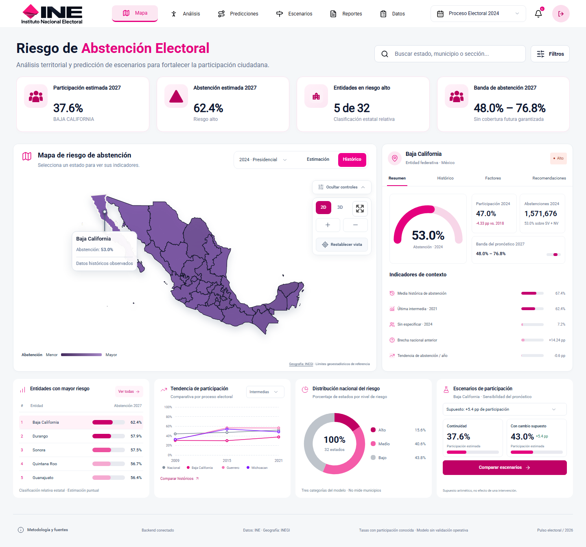

# Atlas De La Participación

Aplicación para explorar participación y abstención electoral en México, comparar entidades,
revisar modelos y calcular escenarios hipotéticos con datos abiertos del INE.
Es un **prototipo experimental**, sin aval institucional del INE y sin validación para decisiones operativas.

**Demo:** [pulso-electoral-demo.vercel.app](https://pulso-electoral-demo.vercel.app).
Requiere una cuenta confirmada de Supabase Auth. El login es público; el dashboard y sus APIs requieren sesión.

### Acceso de prueba para el hackathon

Entrar en [la demo](https://pulso-electoral-demo.vercel.app/login) con una de las dos cuentas confirmadas:

| Correo | Contraseña de demo |
| --- | --- |
| `pulso.qa.20261025.1@example.com` | `PulsoDemo2026!` |
| `pulso.qa.20261025.2@example.com` | `PulsoDemo2026!` |

Ambas cuentas son usuarios normales de la aplicación y comparten acceso público para las pruebas
del hackathon. No guardar información personal en sus escenarios. Los correos son ficticios y no
reciben enlaces de recuperación. La creación y las pruebas de acceso están documentadas en
[Auth](frontend/AUTH.md).


## Guía del proyecto · actualización documental del 29 de octubre de 2026

**Atlas De La Participación** es el nombre del producto. El repositorio, el dominio de
la demo, los usuarios de prueba y los identificadores internos conservan sus nombres
anteriores por compatibilidad. Las credenciales demo de esta página permanecen sin cambios.

- [Machine learning, predicciones y límites](docs/machine-learning.md).
- [Galería del dashboard](docs/dashboard-gallery.md).
- [Instalación](docs/installation.md), [autenticación](frontend/AUTH.md) y [estado del proyecto](docs/project-status.md).
- [Reportes nacionales y escenarios](docs/punto7-reportes-escenarios.md).

Las secciones de pruebas fechadas más abajo son registros históricos de esas versiones,
no certificaciones del despliegue actual. Una rama subida no equivale a una funcionalidad
fusionada ni desplegada. Las capturas conservan la apariencia de la versión fotografiada.

## Estado de la demo y límites

La demo corre en Vercel Hobby con Next.js, Supabase Auth y Groq reales. Usa `PULSO_PREVIEW=1`:
los datos y pronósticos son una instantánea versionada del repositorio. **No hay FastAPI ni
PostgreSQL del backend FastAPI desplegados detrás de esta demo.** Los escenarios calculados
se guardan en Supabase, asociados al usuario autenticado, y se recuperan desde Escenarios.

La implementación completa del backend sí existe en este repositorio y puede ejecutarse en Docker
local o conectarse a PostgreSQL/PostGIS en Supabase. En ese modo, la API conserva simulaciones.
El guardado web usa la tabla `public.pulso_scenarios`, independiente del historial del backend local.
RLS permite a cada usuario insertar y consultar únicamente sus propios escenarios.

La entrega del hackathon incorpora PDF/Excel estatales y retira la muestra municipal de Datos.
[Alcance y validación de la entrega](docs/hackathon-delivery.md).

La revisión funcional del 26 de octubre de 2026 recorrió las ocho secciones. Encontró errores de
presentación de datos y controles de Reportes; las correcciones y el alcance de las pruebas están en
[la auditoría de la app publicada](docs/published-app-audit.md). Las correcciones se publicaron
tras el merge del PR #17, commit `014961e`; navegación móvil, tarjetas y Reportes se comprobaron
en producción. Las pruebas reales de IA y sus límites de cuota se detallan en la auditoría.

## Secciones y alcance real

| Sección | Disponible | Límites y pendientes |
| --- | --- | --- |
| Mapa de riesgo | Cartografía de los 32 estados, selección territorial, estimación 2027, histórico y detalle con cuatro pestañas. | Los límites INEGI son geoestadísticos, no electorales históricos. Los indicadores superiores se corrigieron para usar pronósticos reales del estado seleccionado. |
| Tendencias | Comparación de hasta tres estados, participación/abstención y tabla de procedencia. | Se separan intermedias y presidenciales; no hay series municipales homologadas. Acceso desde «Comparar históricos» en el mapa. |
| Análisis IA | Histórico oficial estatal, nacional ponderado, estimación 2027, búsqueda, CSV trazable y consulta estatal a Groq. | Comparte estado/año y APIs con el mapa; el pronóstico usa la misma corrida que Predicciones. No muestra cifras municipales sin homologación. |
| Laboratorio de modelos | Dos referencias y cuatro modelos ML, métricas temporales, pronósticos para 32 estados, importancia global y escenarios locales. Exporta CSV/JSON. | Entrenamiento previo, no por solicitud. La síntesis automática no es una consulta a IA. Acceso desde Análisis → Preguntar a la IA → Abrir laboratorio de modelos. |
| Predicciones | Baseline estatal 2027, banda, contexto histórico, errores temporales y asistente Groq. | Las bandas no garantizan cobertura futura; no predice municipios ni efectos de intervenciones. |
| Escenarios | Cambio supuesto de participación, límites 0–100%, comparación, guardado privado y recuperación del historial. | Cálculo sobre la instantánea en demo; el historial muestra los últimos 20 escenarios de la entidad. Corridas anteriores no se restauran sobre una base distinta. |
| Reportes | Reporte estatal descargable en PDF y Excel, entidad, variable, comparación nacional ponderada, histórico, hallazgos y metodología. PDF incluye gráficas opcionales; Excel conserva conteos y tasas numéricas. | Comparativo nacional disponible; PowerPoint, envíos automáticos y detalle municipal pendientes. Las últimas cinco descargas se pueden repetir durante la sesión de la sección; no hay archivo persistente de reportes. |
| Datos | Filtros, búsqueda, orden, paginación, selección de filas, CSV/JSON, diccionario y procedencia. | Datos nacionales/estatales oficiales; muestra municipal retirada y opción deshabilitada hasta homologar fuentes. Subir archivos está pendiente. Actualizar fuentes vuelve a consultar los datos disponibles; no descarga nuevas elecciones del INE. |

Mapa, Análisis, Predicciones y Escenarios comparten estado seleccionado; Análisis y el histórico del
mapa también comparten año. El laboratorio usa la selección territorial del dashboard.
La corrección móvil incorpora un selector con las ocho secciones, porque la barra de escritorio
se oculta en pantallas estrechas.
Los avisos de notificaciones y varios elementos visuales siguen siendo referencias del diseño.



[Vista móvil con selector de secciones](docs/screenshots/audit-mobile-20261026.png).
Estas capturas corresponden a la versión local corregida, no a un nuevo despliegue.

### Actualización de Análisis con datos oficiales

La nueva implementación elimina `municipalDemo`, las tasas nacionales fijas y los cambios de
participación inventados de Análisis. Usa `/api/backend/statistics/territories`,
`participation/history` y `statistics/summary`; funciona tanto con FastAPI como con la instantánea
oficial de la demo. No se descarga ni entrena un conjunto nuevo por solicitud.

- **Histórico observado:** participación `SV/(SV+NV)`, abstención `NV/(SV+NV)` y NS separado.
  Cambios y gráficas comparan exclusivamente elecciones del mismo tipo: presidenciales
  2012/2018/2024 o intermedias 2009/2015/2021. El nacional suma conteos, no promedia porcentajes estatales.
- **Estimación 2027:** usa exactamente las tasas, banda, categoría y corrida que Mapa y Predicciones;
  se identifica como experimental. No inventa un pronóstico nacional ponderado.
- Seleccionar una entidad en Análisis actualiza la selección del mapa y Predicciones. La búsqueda,
  comparación y exportación son estatales; el CSV incluye conteos/fuente para observaciones o
  corrida/modelo/banda para estimaciones. La lectura automática se distingue de una respuesta de IA.
- Las tasas observadas de 2024 no deben igualarse al pronóstico de 2027: para Morelos son
  38.6% de abstención observada frente a 48.1% estimada. Coinciden al comparar el mismo modo,
  estado y año entre secciones. Ante errores o datos ausentes no se sustituyen cifras ilustrativas.

El alcance de verificación de esta actualización es local: API Docker e instantánea del repositorio.
Las pruebas reales de producción de la siguiente sección describen el despliegue anterior a este cambio.

Consistencia comprobada al seleccionar la misma entidad y modo en Análisis, Mapa y Predicciones:

| Entidad | Participación observada 2024 | Abstención observada 2024 | Abstención estimada 2027 |
| --- | --- | --- | --- |
| Morelos | 61.4% | 38.6% | 48.1% |
| Baja California | 47.0% | 53.0% | 62.4% |
| Guerrero | 56.7% | 43.3% | 43.7% |

Se contrastaron los conteos de las 32 entidades, el nacional ponderado, periodos comparables,
exportación de CSV y errores sin sustitución por datos ficticios.
[Análisis oficial en escritorio](docs/screenshots/analysis-official-desktop.png) ·
[Versión móvil](docs/screenshots/analysis-official-mobile.png).

## Pruebas reales en producción

Verificadas el **26 de octubre de 2026** sobre la demo:

- Login con Supabase Auth y carga de 32 entidades; logout y denegación de acceso privado sin sesión.
- Mapa: selección de Baja California, detalle histórico, factores y recomendaciones.
- Tendencias: series intermedias 2009/2015/2021 y presidenciales 2012/2018/2024.
- Análisis: filtro por Acapulco y respuesta real de Groq sobre Guerrero.
- Laboratorio: seis estimadores y escenario XGBoost de Baja California, 53.6% → 50.6% al sumar 3 pp de participación.
- Predicciones: datos de Baja California; prueba previa de Groq en Morelos identificada como `IA · qwen/qwen3.8-27b`.
- Escenarios: Baja California −3 pp, abstención 62.4% → 65.4%; cambiar el supuesto invalida el resultado.
- Datos: búsqueda «baja», dos filas estatales, descarga CSV y muestra municipal identificada como ilustrativa.
- Reportes: vista previa y reproducción de los errores de alcance nacional y paginación, corregidos en código local.
- Metodología: fórmulas, fuentes, límites del semáforo y cartografía visibles.

Esto no sustituye pruebas de carga, auditoría de accesibilidad completa ni validación con usuarios.
El detalle de cobertura y regresiones está en [la auditoría](docs/published-app-audit.md).

## Acceso con Supabase Auth

Proyecto `ine-abstention` (`npzgdyyzdcsdadtfxhmr`). Se crearon dos usuarios QA mediante Auth Admin,
con confirmación individual, sin desactivar la confirmación global ni habilitar acceso anónimo:

| Usuario de prueba | Estado probado |
| --- | --- |
| `pulso.qa.20261025.1@example.com` | Confirmado; login y logout reales, incluida la demo publicada. |
| `pulso.qa.20261025.2@example.com` | Confirmado; login y logout reales en la prueba local previa. |

Las credenciales públicas para evaluadores están en [Acceso de prueba para el hackathon](#acceso-de-prueba-para-el-hackathon).
Estos buzones ficticios no reciben mensajes; si se cambia la contraseña en Supabase, actualizar también
la tabla de acceso de este README.

Site URL: `https://pulso-electoral-demo.vercel.app`. Callbacks autorizados:

- `https://pulso-electoral-demo.vercel.app/auth/callback`
- `https://pulso-electoral-demo.vercel.app/auth/callback?next=/reset-password`

Registro y recuperación tienen interfaz, pero **el ciclo completo por correo sigue pendiente**.
El proveedor rechazó las direcciones ficticias con HTTP 400; crear usuarios con Auth Admin no prueba
registro público ni recepción de correo. SMTP personalizado sigue deshabilitado.
Se necesitan buzones reales controlados y un servicio de correo adecuado.
[Configuración y resultados completos de Auth](frontend/AUTH.md).

## Arquitectura y modos de ejecución

```text
Demo publicada
Navegador → Supabase Auth
          → Next.js en Vercel → instantánea del repositorio
                              → Groq desde el servidor
                              → Supabase: escenarios privados con RLS

Backend conectado
INE CCPC → validación e ingesta → PostgreSQL/PostGIS
                                     ↕
                         FastAPI /api/v1 + modelos materializados
                                     ↕
                     Next.js /api/backend → dashboard React
```

El navegador nunca recibe la clave de Groq, credenciales PostgreSQL ni claves administrativas de
Supabase. La URL y clave publicable de Supabase sí son configuración pública del cliente.
El login protege las APIs Next.js; una futura API FastAPI pública requiere su propia protección.

### Variables de la demo

En Vercel, Production y Preview:

```env
PULSO_PREVIEW=1
AI_PROVIDER=groq
GROQ_MODEL=qwen/qwen3.8-27b
NEXT_PUBLIC_SUPABASE_URL=https://TU_PROYECTO.supabase.co
NEXT_PUBLIC_SUPABASE_PUBLISHABLE_KEY=TU_CLAVE_PUBLICABLE
GROQ_API_KEY=TU_CLAVE_PRIVADA
```

En Production: `NEXT_PUBLIC_APP_URL=https://pulso-electoral-demo.vercel.app`.
Guardar `GROQ_API_KEY` como secreto de servidor, nunca con prefijo `NEXT_PUBLIC_` ni en Git.
En Preview, configurar el origen y callbacks exactos si se probarán flujos de email.
Después de cambiar variables, reconstruir el despliegue.
Proyecto Vercel `pulso-electoral-demo`, raíz `frontend`, build `npm run build`, con acceso a
archivos fuera de la raíz para importar `data/samples/ml_laboratory.json`.
[Guía de Groq y despliegue](frontend/GROQ.md).

## Datos, modelos y límites metodológicos

- CCPC 2009, 2012, 2015, 2018, 2021 y 2024; inventario y checksum SHA-256.
- En la ingesta completa se validaron 54,872,712 filas originales y se cargaron 14,971 registros
  territoriales y 139,653 desgloses demográficos. Son cifras del backend, no del tamaño de la instantánea web.
- Participación: `SV/(SV+NV)`; abstención: `NV/(SV+NV)`. `NS` se conserva por separado.
  El nacional suma conteos; la media estatal da el mismo peso a cada entidad.
- Referencia elegida: `baseline_last`, repetición de la intermedia 2021. MAE de prueba 2024: **3.49 pp**.
- Desarrollo temporal: 2018/2021; prueba reservada: 2024. No se elige retrospectivamente el modelo con esa prueba.
- Laboratorio web: 192 observaciones estatales y 128 ejemplos supervisados; Ridge, Random Forest,
  XGBoost y LightGBM, además de las dos referencias. Usa agregados sin desgloses demográficos;
  sus métricas no sustituyen las del experimento original con variables adicionales.
- Bandas empíricas calibradas con un bloque intermedio: soporte limitado, sin cobertura futura garantizada.
  El semáforo es relativo y no es un estándar oficial del INE.
- Escenarios aritméticos, sin interpretación causal, recomendación de campañas ni predicción de sus efectos.

Para regenerar el laboratorio:

```powershell
uv sync --group ml --group dev --locked
uv run python scripts/train_web_ml.py
```

El informe se guarda en `data/samples/ml_laboratory.json`; pesos locales en `artifacts/models/`,
ignorados por Git. La API sirve el informe sin entrenar por petición.

## Ejecutar en local

Requisitos: Node.js 24 y npm; para backend, Python 3.12+, uv y PostgreSQL/PostGIS o Docker Desktop.
No sobrescribir `.env` ni `frontend/.env.local` existentes.

### Frontend con instantánea

Configurar las variables públicas de Auth y `NEXT_PUBLIC_APP_URL=http://127.0.0.1:3000`
en `frontend/.env.local`; Groq es opcional para la lectura automática de respaldo.

```powershell
cd frontend
npm.cmd ci
npm.cmd run preview
```

Abrir `http://127.0.0.1:3000`. Requiere login también en modo instantánea.
Webpack se usa explícitamente por un fallo observado de Turbopack en Windows.

### Frontend con backend Docker

Un clon nuevo no incluye una base activa ni los ZIP originales. El paquete verificado
`tests/fixtures/ci.tar.gz` permite restaurar agregados y modelos para demo/CI:

```powershell
uv sync --locked --group ml
uv run python scripts/ci_fixtures.py restore
docker compose --env-file .env.docker.example --profile demo build
docker compose --env-file .env.docker.example --profile demo run --rm seed
docker compose --env-file .env.docker.example up -d --wait api
```

Configurar `BACKEND_URL=http://127.0.0.1:8001` y quitar `PULSO_PREVIEW=1` del entorno local.
Conservar las variables de Auth; después, en `frontend`, ejecutar `npm.cmd run dev`.
API: `http://127.0.0.1:8001/docs`; disponibilidad: `/api/v1/health/ready`.
Las credenciales de `.env.docker.example` son exclusivamente locales.

Para conectar FastAPI a Supabase, usar las conexiones del entorno privado y ejecutar:

```powershell
uv sync --locked --group ml
uv run alembic upgrade head
uv run uvicorn app.main:app --host 127.0.0.1 --port 8000
```

En ese caso, `BACKEND_URL=http://127.0.0.1:8000`.
[Instalación desde cero](docs/installation.md) · [Supabase/PostGIS](docs/supabase.md).

## Verificación y CI

```powershell
# Raíz: backend
uv run ruff check app pipelines scripts tests
uv run --locked --group ml pytest

# frontend
npm.cmd run test:unit
npm.cmd run build
npm.cmd run typecheck
npm.cmd run test:e2e
```

Las pruebas de integración requieren una base activa, migraciones y datos; ver [CI](docs/ci.md).
Las de navegador requieren backend local y frontend con Auth de prueba configurado según esa guía.
Playwright levanta una fixture Auth local; **no demuestra que funcione el correo de Supabase real**.
No apuntar esa fixture a producción ni publicar su estado de sesión.

Validación local con Análisis oficial: **11 pruebas unitarias y 27 pruebas de navegador aprobadas**,
más **3 pruebas de navegador en modo instantánea**, compilación de producción y TypeScript correctos.
Incluye consistencia entre secciones, nacional ponderado, CSV oficial, navegación móvil, errores,
controles pendientes de Reportes y contexto de respuestas de IA.

GitHub Actions comprueba backend (unitarias, ML e integración) y frontend (unidades, tipos,
compilación y navegador). Vercel genera previews de ramas y despliega `main` automáticamente.
Tras el merge del PR #16, commit `5be0ab3`, ambos jobs de CI y Vercel aprobaron; se verificaron
HTTP 200 en login, redirección 307 al entrar sin sesión y 401 en las dos APIs privadas.

## Qué falta para completar el producto

1. **Correo y acceso de evaluadores:** SMTP, registro/confirmación/recuperación con buzones reales,
   revisión del aviso de privacidad, ayuda y términos; roles y permisos si habrá usuarios con distinto acceso.
2. **Datos en producción:** desplegar FastAPI y proteger su API si se requiere actualizar datos
   desde una base activa. La demo usa una instantánea; el historial privado de escenarios ya usa Supabase.
3. **Cobertura municipal:** incorporar registros homologados antes de habilitar ese nivel; la muestra
   ilustrativa fue retirada. Retirar también notificaciones ficticias del diseño.
4. **Ampliación de reportes:** PowerPoint, contenido nacional/municipal, historial persistente,
   factores y programación de envíos. PDF y Excel estatales ya están implementados.
5. **Operación:** límites de solicitudes y cuota por usuario para IA, monitoreo de errores,
   alertas, copias/restauración verificadas y pruebas de carga. HTTPS y secretos de servidor ya existen en Vercel.
6. **Calidad y método:** WCAG con tecnologías de asistencia, prueba con usuarios, más bloques electorales,
   validación externa, auditoría de fechas de publicación y sesgo por registros NS.
7. **Mantenimiento:** optimizar cartografía de 28.8 MB con trazabilidad, automatizar actualización validada
   de fuentes y elegir licencia para el código.

## Estructura y guías

```text
app/                 FastAPI, estadísticas, modelos y servicios
alembic/             Migraciones PostgreSQL
pipelines/           Ingesta y transformación de fuentes INE
scripts/             Descarga, entrenamiento, predicción, restauración y demo
frontend/            Next.js, componentes, APIs privadas y pruebas
tests/               Pruebas backend y fixtures verificadas
docs/                Metodología, instalación, auditorías y resultados
data/, artifacts/    Datos y pesos; algunos informes/muestras sí están versionados
```

- [Auditoría de la app publicada](docs/published-app-audit.md).
- [Frontend](frontend/README.md), [Auth](frontend/AUTH.md), [Groq](frontend/GROQ.md).
- [Instalación](docs/installation.md), [Docker](docs/docker_validation.md), [CI](docs/ci.md).
- [Metodología de datos](docs/phase2.md), [estadística](docs/phase3.md), [modelos](docs/phase4.md),
  [predicciones](docs/phase5.md), [simulaciones](docs/phase6.md), [integración backend](docs/phase7.md).
- [Hoja de ruta histórica](docs/project-status.md): consultar junto con esta auditoría; algunas prioridades
  preceden al despliegue y a la incorporación de Supabase Auth.

## Punto 7 · Reportes y escenarios (rama de trabajo)

Consulte [documentación del punto 7](docs/punto7-reportes-escenarios.md):
comparativos nacionales PDF/Excel y comparador multiestado exploratorio,
pendientes de CI. Se conservan los reportes estatales y los escenarios privados.
No están habilitados todavía PowerPoint, envíos programados ni reportes municipales.

## Punto 9 · Experiencia y entrega (octubre de 2026)

Se añadieron guías de [accesibilidad](docs/punto9-accesibilidad.md),
[pruebas con usuarios](docs/punto9-pruebas-usuario.md) y
[entrega al equipo receptor](docs/punto9-entrega.md).
La [licencia del código](docs/LICENCIA_PENDIENTE.md) requiere aprobación de sus titulares.
Las páginas públicas `/privacidad`, `/terminos` y `/soporte` son preliminares:
se debe completar y aprobar la documentación legal y el contacto de soporte antes
 de abrir el registro al público. Atlas De La Participación no es una plataforma oficial del INE.

## Punto 8 · Operación y seguridad

Consultar [el plan de operación y seguridad](docs/punto8-operacion-seguridad.md)
para la clave interna de FastAPI, logs con correlación, métricas, monitor,
respaldo/restauración, pruebas de concurrencia y aislamiento multiusuario.
No pasar a producción sin configurar secretos y servicios externos verificables.

## Punto 6 · Validación de pronósticos

La [auditoría temporal y de calidad](docs/punto6-validacion.md) presenta
los errores 2018/2021/2024, la sensibilidad NS y las limitaciones de la
banda 2027. El [diagnóstico reproducible](docs/punto6_validacion.json) tiene
resultados por estado y se muestra en Predicciones. **No constituye una
validación externa independiente ni acredita uso operativo.**
