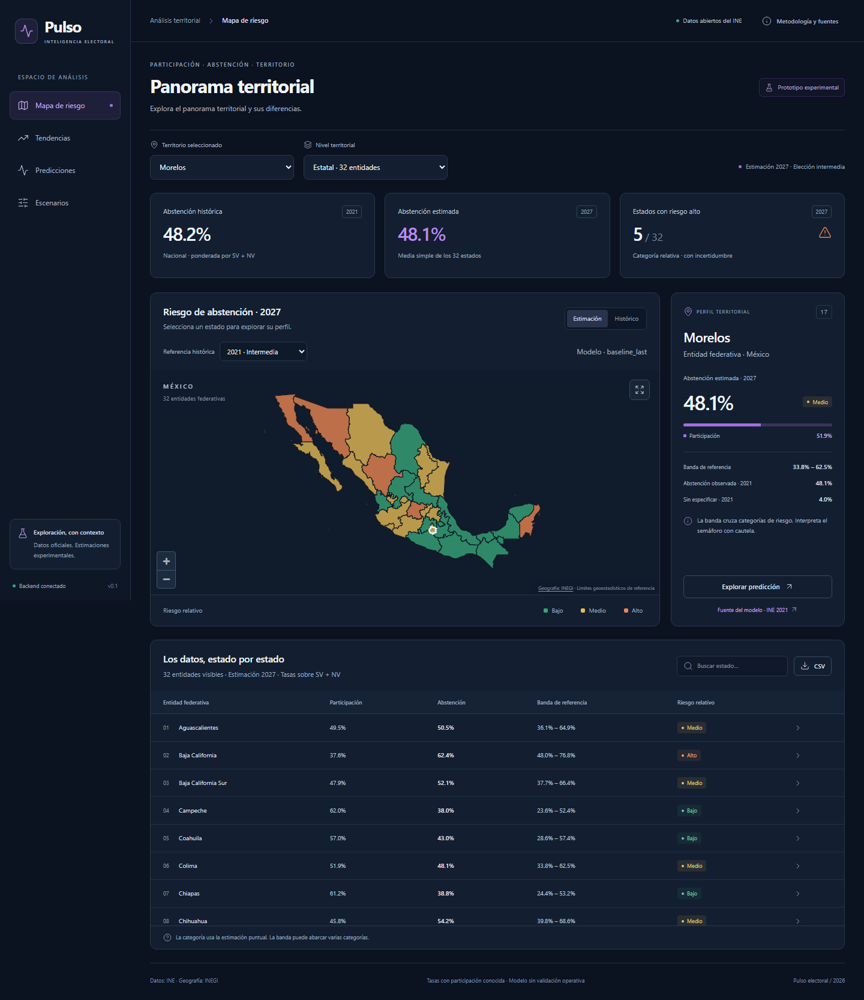

# Pulso electoral · INE Abstention

Dashboard y API para explorar participación y abstención electoral en México, comparar territorios
y construir escenarios hipotéticos con datos oficiales del INE. El objetivo es apoyar la exploración
territorial con evidencia y supuestos visibles; no recomendar intervenciones ni afirmar efectos causales.

**Estado:** prototipo funcional, con backend de fases 1–7 y frontend de ocho secciones.
La estimación futura disponible es estatal, para las elecciones intermedias de 2027.
No es un producto oficial del INE ni está validado para decisiones operativas.

## Qué está hecho

| Área | Funcionalidad disponible |
| --- | --- |
| Datos oficiales | Descarga, inventario, SHA-256, validación e ingesta de CCPC 2009, 2012, 2015, 2018, 2021 y 2024. |
| Backend | FastAPI, SQLAlchemy, PostgreSQL/PostGIS, migraciones, procedencia, indicadores y API documentada. |
| Modelos | Dos referencias históricas y cuatro candidatos; desarrollo temporal 2018/2021 y prueba final 2024. |
| Riesgo | 32 predicciones estatales, tres categorías relativas, bandas empíricas y explicación del baseline. |
| Simulador | Escenarios aritméticos persistidos, cambios de participación en puntos porcentuales y límites 0–100%. |
| Dashboard | Laboratorio de modelos, Análisis IA, Mapa, Tendencias, Predicciones, Escenarios, Reportes y Datos; API, búsqueda, exportación y diseño adaptable. |
| Cartografía | Polígonos de los 32 estados del servicio oficial INEGI, con procedencia y checksum. Son referencia geoestadística. |

El dashboard conserva el territorio al cambiar de sección. El mapa permite elegir estados y alternar
observaciones históricas con estimaciones. Tendencias compara hasta tres entidades sin mezclar tipos
de elección. Predicciones muestra el modelo, sus errores temporales y sus límites. Escenarios consulta
el backend, guarda el resultado y evita mostrar resultados anteriores como si correspondieran a nuevos parámetros.



[Ver el simulador](docs/screenshots/scenario.png) · [Ver la versión móvil](docs/screenshots/mobile.png)

Datos permite filtrar y descargar CSV/JSON de registros nacionales y estatales. Su nivel municipal
usa una muestra ilustrativa identificada como no oficial; no habilita series municipales homologadas.
Reportes ofrece configuración y vista previa del documento; la generación de PDF/PowerPoint/Excel
y los envíos programados todavía no están implementados.

## Acceso y revisión de Supabase Auth

El frontend incorpora login, registro, recuperación y cierre de sesión con Supabase Auth.
El 26 de octubre de 2026 se crearon y comprobaron dos cuentas ficticias en el proyecto real
`ine-abstention` (`npzgdyyzdcsdadtfxhmr`), mediante Auth Admin y confirmación individual:

| Usuario de prueba | Resultado |
| --- | --- |
| `pulso.qa.20261025.1@example.com` | Creado, confirmado; login y logout reales aprobados. |
| `pulso.qa.20261025.2@example.com` | Creado, confirmado; login y logout reales aprobados. |

La primera cuenta cargó el dashboard con datos de los 32 estados. Se comprobó el rechazo de
contraseña incorrecta, la validación de contraseñas distintas en registro y la denegación de la API
privada después del logout. Ambas cuentas quedaron sin sesiones activas al terminar las pruebas.

El registro público previo rechazó estas direcciones ficticias; la creación administrativa sí
funcionó. La recuperación real devolvió HTTP 400 por dirección inválida. No se verificaron
recepción de correo ni cambio de contraseña. La confirmación global sigue obligatoria y el acceso
anónimo deshabilitado; no se modificaron esas políticas para crear las cuentas.

Pendientes antes de una prueba de correo completa: Site URL todavía es `http://localhost:3000`,
no hay Redirect URLs autorizadas y SMTP personalizado está deshabilitado. Se necesitan una URL
de destino configurada y direcciones reales controladas para completar registro y recuperación.
Los resultados, identificadores y límites están en [la guía de Auth](frontend/AUTH.md#revisión-del-proyecto-real).
Las contraseñas, tokens y claves no se incluyen en la documentación.

## Laboratorio de machine learning e IA

La sección **Laboratorio de modelos** compara Ridge, Random Forest, XGBoost y LightGBM con dos referencias históricas. Los seis estimadores se entrenan con los agregados estatales 2009–2024: 192 observaciones y 128 ejemplos supervisados. Esta corrida usa la muestra CSV, sin desgloses demográficos; sus métricas no sustituyen las del experimento original con variables adicionales.

- Desarrollo con elecciones completas 2018/2021; prueba reservada 2024. El entrenamiento de cada corte solo usa elecciones anteriores.
- Pronósticos materializados para los 32 estados en 2027, bandas empíricas específicas de cada modelo y su importancia interna global cuando el algoritmo la ofrece.
- El laboratorio genera una síntesis automática basada en tasas y errores medidos. Los asistentes de Análisis IA y Predicciones admiten Groq (predeterminado), Gemini u Ollama, configurados en el servidor; si el proveedor no está disponible, muestran una lectura automática identificada como tal.
- Escenarios locales de sensibilidad: trasladan el pronóstico ML y su banda por un cambio supuesto de participación; no reentrenan el estimador ni estiman efectos de intervenciones. Se invalidan si cambia el modelo, la entidad o el supuesto. Exportación CSV de pronósticos y JSON de escenarios.

Para reproducir el entrenamiento desde la raíz:

```powershell
uv sync --group ml --group dev --locked
uv run python scripts/train_web_ml.py
```

Los pesos, el protocolo y los errores por corte se conservan en `artifacts/models/<run_id>/` (ignorado por Git). El informe materializado se guarda en `data/samples/ml_laboratory.json` e incluye checksums, versiones de paquetes y trazabilidad de variables. La API sirve **GET /api/v1/ml/laboratory** sin cargar pesos, entrenar por petición o consultar la base de datos. El contenedor incluye solo el informe JSON.

En `frontend/`, `npm run preview` permite abrir el laboratorio sin FastAPI. `npm run dev` consulta la API real mediante el proxy habitual. Se conserva la referencia `baseline_last` elegida en desarrollo; el mejor candidato ML puede explorarse sin promocionarlo a producción. Las bandas usan únicamente errores intermedios de 2021, un bloque de calibración con soporte limitado.

Validación: `uv run pytest tests/unit tests/ml -q`, `npm run typecheck` y `npm run build` en el frontend.

## Cómo funciona

```text
Fuentes CCPC del INE → validación e ingesta → PostgreSQL/PostGIS
                                                ↕
                               FastAPI /api/v1 + resultados materializados
                                                ↕
                         Proxy privado de servidor Next.js /api/backend
                                                ↕
                          Dashboard React + MapLibre + Apache ECharts
                          ↑ cartografía contextual oficial del INEGI
```

La base puede ejecutarse en Supabase o en Docker local. El navegador consulta FastAPI mediante
Next.js; nunca recibe las contraseñas de PostgreSQL ni claves administrativas de Supabase.
El frontend no modifica el entrenamiento, las predicciones base ni el esquema de datos.

La participación observada es `SV/(SV+NV)` y la abstención `NV/(SV+NV)`. `NS` se conserva por separado.
El indicador nacional agrega conteos; la media de predicciones estatales da igual peso a cada estado.
Son estadísticas distintas y están identificadas en pantalla.

El modelo seleccionado es `baseline_last`: repite el dato de la última elección del mismo tipo, 2021.
Su MAE en la prueba temporal 2024 es aproximadamente **3.49 puntos porcentuales**. Se eligió con
desarrollo 2018/2021; un candidato con menor error en 2024 no reemplaza retrospectivamente esa selección.
Las bandas empíricas no tienen cobertura futura garantizada. El semáforo no es un estándar oficial del INE.

## Abrir el dashboard

Requisitos: Node.js 24, npm y una API con datos, modelos y predicciones cargados.
En este equipo, el backend Docker está en `http://127.0.0.1:8001`.

```powershell
# En la raíz, si el volumen local ya está preparado:
docker compose --env-file .env.docker.example up -d --wait api

cd frontend
npm.cmd ci
npm.cmd run dev
```

Abrir **http://127.0.0.1:3000**. Para la API local sobre Supabase en puerto 8000, crear
`frontend/.env.local` con `BACKEND_URL=http://127.0.0.1:8000`. No sobrescribir el `.env` de la raíz.
Se utiliza Webpack de forma explícita por un fallo observado de Turbopack al iniciar procesos auxiliares en Windows.

Un clon nuevo **no incluye una base activa ni los ZIP electorales**. Incluye un paquete verificado de agregados y modelos congelados en `tests/fixtures/ci.tar.gz`, restaurable para la demo local y CI; no incluye todos los pesos de entrenamientos locales.
Se puede restaurar ese paquete, conectar una API ya preparada o reconstruir la base siguiendo [la instalación desde cero](docs/installation.md).
Las variables de ejemplo usan únicamente credenciales locales de desarrollo.

## Qué falta y cómo mejorarlo

Prioridades y criterios de aceptación en [estado y hoja de ruta](docs/project-status.md).

1. **Antes de desplegar:** autenticación/autorización, límites de solicitudes, HTTPS, gestión de secretos,
   copias/restauración y monitoreo. El prototipo se sirve solo en localhost.
2. **Para mejorar las estimaciones:** más bloques electorales, auditoría de fechas de publicación, evaluación
   de sesgo por NS y validación externa. Hoy hay pocas elecciones y la incertidumbre tiene soporte limitado.
3. **Para bajar de nivel territorial:** correspondencias municipales verificadas y cartografía electoral
   homologada. No se habilitan series municipales, distritales o seccionales por repetir códigos.
4. **Para ampliar el producto:** escenarios multiterritoriales en la interfaz, historial de simulaciones,
   exportaciones de reportes, análisis demográfico y revisión WCAG con usuarios y tecnologías de asistencia.
5. **Para mantenerlo:** revisar dependencias y resultados del CI existente, añadir pruebas de carga y optimizar la capa
   geográfica de 28.8 MB mediante un proceso verificable. No se ha elegido una licencia de distribución del código.

## Estructura y documentación

```text
app/                 API, estadísticas, modelos y servicios
alembic/             Migraciones de PostgreSQL
pipelines/           Ingesta y transformación de datos oficiales
scripts/             Descarga, carga, entrenamiento, predicción y demostración
frontend/            Next.js, componentes, cliente tipado y pruebas de navegador
tests/               Pruebas unitarias, ML e integración del backend
docs/                Metodología, resultados, instalación y pendientes
data/, artifacts/    Datos y pesos locales, excluidos de Git
```

- [Guía del frontend](frontend/README.md): ejecución, variables, contratos y pruebas.
- [Validación del dashboard](docs/frontend-validation.md): alcance probado y límites pendientes.
- [Instalación nueva](docs/installation.md): reconstrucción con fuentes oficiales.
- [Estado del proyecto](docs/project-status.md): entregado, faltantes y mejoras.
- [Fases 2–7](docs/phase7.md): metodología y validación histórica del backend.

---

## Backend: fases 1 a 7

Base del backend del Sistema Inteligente de Predicción de Riesgo de Abstención Electoral.
Fases 1 a 7: FastAPI, PostgreSQL/PostGIS, ingesta CCPC, estadística, predicciones y simulaciones territoriales.
Supabase contiene seis elecciones, agregados estatales/municipales y distribuciones demográficas.
Se entrenaron referencias históricas y cuatro candidatos sobre observaciones estatales.
El escenario 2027 incorpora semáforo histórico, bandas empíricas y explicaciones del modelo seleccionado.
El simulador compara continuidad con cambios hipotéticos de participación y conserva los supuestos en Supabase.

## Ejecución con Supabase (configuración actual)

PostgreSQL/PostGIS se aloja en Supabase Free. FastAPI se ejecuta localmente sin Docker.
El `.env` local ya contiene las conexiones; no sobrescribirlo con `.env.example`.

```powershell
uv sync --locked
uv run alembic upgrade head
uv run uvicorn app.main:app --host 127.0.0.1 --port 8000
```

Consultar `docs/supabase.md` para los roles, conexión SSL y pruebas de integración.
La [guía de integración y demostración](docs/phase7.md) distingue Compose local y Compose sobre Supabase.

## Datos oficiales

El inventario, las variables y los límites de comparabilidad están en [docs/phase2.md](docs/phase2.md).
Se validaron 54,872,712 filas originales y se cargaron 14,971 registros territoriales y 139,653
desgloses demográficos. Los originales se conservan localmente con checksum SHA-256.

```powershell
uv run python scripts/inspect_ccpc.py
uv run python scripts/prepare_ccpc.py
uv run alembic upgrade head
uv run python scripts/load_ccpc.py
uv run python scripts/report_ccpc.py
```

La carga omite fuentes ya procesadas sin duplicar datos. Consultas:

- `/api/v1/data-sources`: procedencia de los ZIP oficiales.
- `/api/v1/elections`: elecciones disponibles.
- `/api/v1/participation/history?state_code=17`: historia estatal de Morelos.

La abstención se calcula como `NV/(SV+NV)`, conforme al manual INE. `NS` representa información
no especificada y se conserva aparte. La comparación municipal entre años requiere homologación.

## Estadísticas y tendencias

Las fórmulas, unidades y límites están en [docs/phase3.md](docs/phase3.md).
Consultar [docs/phase3_results.md](docs/phase3_results.md) para el análisis calculado sobre Supabase.

- `/api/v1/statistics/summary?year=2024`: indicadores nacionales.
- `/api/v1/statistics/trends?state_code=17`: tendencias de Morelos por tipo de elección.
- `/api/v1/statistics/territories?year=2024`: indicadores y comparaciones territoriales.
- `/api/v1/statistics/demographics?dimension=sex&year=2024`: distribución por sexo.

Se comparan elecciones del mismo tipo. Las tendencias municipales permanecen pendientes de
homologación. Para regenerar los informes y el CSV de indicadores estatales:

```powershell
uv run python scripts/report_statistics.py
```

## Modelos y evaluación temporal

La metodología, elegibilidad y límites de disponibilidad histórica están en [docs/phase4.md](docs/phase4.md).
Resultados: [docs/phase4_results.md](docs/phase4_results.md). Son 128 ejemplos estatales elegibles,
evaluados con elecciones completas de 2018, 2021 y 2024 fuera del entrenamiento de cada corte.
La selección usa solo 2018 y 2021; 2024 es una prueba final que no cambia esa selección.

```powershell
uv sync --group ml
uv run --group ml alembic upgrade head
uv run --group ml python scripts/train_models.py --register
```

`GET /api/v1/models/metrics` devuelve métricas y versiones registradas. Los artefactos locales
incluyen pesos de evaluación y pesos finales separados, fuentes, variables con linaje y SHA-256.
La validación es retrospectiva por año electoral; no certifica las fechas de publicación de cada
versión histórica. Las fases 5 y 6 incorporan pronósticos y bandas empíricas con sus limitaciones.

## Ejecución con Docker (alternativa local)

Requisitos: Docker Desktop activo con contenedores Linux y Docker Compose.
Desde PowerShell, en la raíz del proyecto:

```powershell
uv run python scripts/demo_bundle.py export
docker compose --env-file .env.docker.example build
docker compose --env-file .env.docker.example --profile demo run --rm seed
docker compose --env-file .env.docker.example up -d api
uv run python scripts/demo_backend.py --api-url http://127.0.0.1:8001
```

Compose inicia PostgreSQL, espera su disponibilidad, aplica Alembic y arranca la API.
Las credenciales incluidas son exclusivamente para desarrollo local. API y base se publican
solo en la interfaz local. Si cambias usuario o contraseña, usa valores compatibles con URL
o configura explícitamente las cadenas de conexión antes de ejecutar.

- OpenAPI de Compose local: http://localhost:8001/docs
- Estado del proceso: http://localhost:8001/api/v1/health
- Conexión, PostGIS y esquema: http://localhost:8001/api/v1/health/ready

```powershell
docker compose --env-file .env.docker.example logs api migrate
docker compose --env-file .env.docker.example down
```

`down` conserva el volumen de datos. Las migraciones requieren un usuario autorizado para
crear extensiones; el usuario local de Compose cuenta con ese permiso.

## Desarrollo local con uv

Requisitos: Python 3.12 o superior y uv. PostgreSQL puede ejecutarse con Compose.

```powershell
uv sync --locked
uv run alembic upgrade head
uv run uvicorn app.main:app --reload
```

`DATABASE_URL` usa el driver `postgresql+psycopg`. CORS se configura con una lista JSON
en `CORS_ORIGINS`; por defecto no se permiten orígenes externos.
Este flujo usa el `.env` existente de Supabase. Para una instalación nueva con una base propia,
configurar `.env.example` sin sobrescribir credenciales existentes.

## Verificación

```powershell
uv run ruff check .
uv run ruff format --check .
uv run --locked --group ml pytest
$env:RUN_INTEGRATION = '1'
$env:RUN_ML_INTEGRATION = '1'
$env:RUN_FORECAST_INTEGRATION = '1'
$env:RUN_SIMULATION_INTEGRATION = '1'
uv run --locked --group ml pytest -m integration
Remove-Item Env:RUN_INTEGRATION, Env:RUN_ML_INTEGRATION, Env:RUN_FORECAST_INTEGRATION, Env:RUN_SIMULATION_INTEGRATION
```

En Windows con permisos restringidos, consultar [la ejecución local de pruebas](docs/ci.md#ejecución-local-en-windows): usar caché de uv y temporales de pytest dentro de `tmp/`.

Las pruebas de integración necesitan la base activa, las migraciones y los seis años cargados.
Las pruebas normales
no requieren conexión. Para nuevas migraciones: `uv run alembic revision --autogenerate -m "descripcion"`;
revisar el archivo generado antes de aplicar `uv run alembic upgrade head`.

## Estructura

- `app/api/v1`: rutas versionadas.
- `app/core`: configuración, sesiones y logging JSON.
- `app/db/models`: base declarativa de SQLAlchemy.
- `app/schemas`: contratos de respuesta; `repositories` y `services`: consultas y estadísticas.
- `app/ml`: variables históricas, modelos, cortes temporales, artefactos y registro de versiones.
- `pipelines`: catálogo de fuentes, validación, agregación y carga CCPC.
- `alembic`: migraciones explícitas; la API no crea tablas al iniciar.
- `tests`: pruebas unitarias e integración con PostGIS real.
- `data`, `artifacts`, `notebooks`, `docs`, `scripts`: espacios para etapas posteriores.

La fase 5 incorpora predicciones estatales 2027, semáforo histórico, bandas empíricas y explicaciones
en la API. Consulta [el protocolo y los límites de interpretación](docs/phase5.md).
La fase 6 añade `POST /api/v1/simulations` y consulta de escenarios registrados mediante GET.
Consulta [fórmulas y supuestos](docs/phase6.md) y [la demostración calculada](docs/phase6_results.md).
El frontend y las geometrías estatales contextuales ya están integrados. Las correspondencias territoriales temporales siguen pendientes.
La fase 7 añade catálogo territorial, datos de mapa con geometría ausente explícita, índice de
consultas y demostración integral: `uv run python scripts/demo_backend.py`.
Compose local está construido y validado: API saludable en http://127.0.0.1:8001/docs,
restauración e idempotencia verificadas, 96 pruebas y 26 comprobaciones HTTP aprobadas.
Ver [la validación Docker](docs/docker_validation.md) y [los pasos de reproducción](docs/phase7.md).
