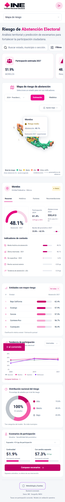

# Galería · Atlas De La Participación

Capturas existentes del repositorio. Documentan versiones anteriores al cambio de
nombre; no representan una comprobación nueva de producción ni del diseño de las ramas pendientes.

## Dashboard y mapa

## Análisis de datos oficiales

## Predicciones

## Reportes

## Escenarios

## Vista móvil

